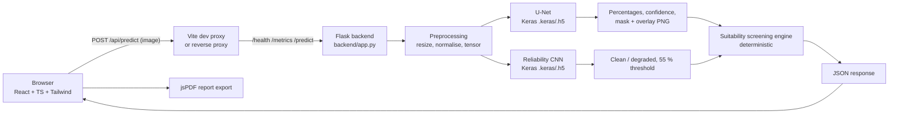

# SiteWise AI

**U-Net–based satellite image semantic segmentation with preliminary site-use suitability screening.**

University Deep Learning project — VIT-AP University.

> ⚠️ **Disclaimer:** SiteWise AI outputs are *preliminary, project-defined screening
> recommendations* for exploration and demonstration purposes. They are **not**
> construction approvals, engineering feasibility studies, or legally verified
> land-use decisions.
> 
> ✅ **Trained Models Included:** Trained models are located in `Trained_Model/` and `backend/models/`:
> - `unet_model.keras` (Keras 3 deep convolutional encoder-decoder)
> - `unet_model.onnx` (Low-memory ONNX Runtime optimized model, ~7.4 MB)
> - `unet_model.tflite` (Quantized TensorFlow Lite engine, ~1.9 MB)

---

## 1. Overview

SiteWise AI lets a user upload a satellite/aerial image (JPG/PNG), have it segmented
pixel-by-pixel into land-cover classes by a U-Net semantic segmentation model,
assessed for *image reliability* by a separate CNN, and finally screened — by a
transparent deterministic scoring engine — for eight preliminary site-use
suitability categories.

The pipeline:

**Upload → Preprocessing → U-Net Segmentation → Land-Cover Analysis → Reliability
Assessment → Suitability Screening → Results Dashboard**

## 2. Objectives

1. Demonstrate encoder–decoder semantic segmentation (U-Net) on real satellite
   imagery rather than image-level classification.
2. Show honest ML engineering: model provenance is per-component, demonstration
   data is never mixed with model output, and no metric is ever fabricated.
3. Convert segmentation statistics + simple RGB features into explainable,
   deterministic preliminary suitability rankings.

## 3. Problem Statement

Given a single RGB satellite tile, (a) predict the land-cover class of *every
pixel*, (b) judge whether the image itself looks clean or degraded before trusting
downstream analysis, and (c) rank eight land-use categories as a *screening aid*.
Image-level classification is not sufficient — land-use planning questions are
spatial ("how much of this plot is built-up?").

## 4. Proposed Solution

| Stage | Component | Nature |
|---|---|---|
| 1 | Upload panel (React) | JPG/JPEG/PNG, content-validated, 16 MB limit |
| 2 | `services/preprocessing.py` | RGB → resize to model input → 0–1 → tensor |
| 3 | U-Net (Model 1) | Deep learning, 7-channel softmax output |
| 4 | `services/segmentation.py` | argmax → percentages, confidence, mask/overlay PNG |
| 5 | Reliability CNN (Model 2) | separate CNN, clean/degraded vs. 55 % threshold |
| 6 | Suitability Engine (Model 3) | **deterministic scoring engine**, not an NN |
| 7 | Results dashboard (React) | segmentation viewer, distribution, features, rankings |

An original project used EfficientNetB0 for *image-level classification* of the
EuroSAT dataset. This project supersedes that approach: EuroSAT's standard images
have **no pixel-level masks**, so supervised segmentation is trained on the
DeepGlobe Land Cover dataset instead. EfficientNetB0 is no longer part of the
active pipeline (it is mentioned only to explain the transition).

## 5. Key Features

- Drag-and-drop upload with preview, dimensions and status; 16 MB / dimension guards.
- Segmentation viewer: Original / Mask / Overlay tabs + interactive before–after comparison slider.
- 10-class→7-class land-cover mapping (DeepGlobe) with consistent colours in backend, legends and charts.
- Per-pixel confidence = softmax probability of each pixel's assigned class (no fabricated values).
- Reliability check with a separate CNN; label distinguishes CNN score from fallback heuristic.
- Eight RGB visual features displayed as compact metric cards.
- Eight suitability categories with ranked bars, explanations and a highlighted top recommendation.
- Downloadable PDF analysis report with per-section provenance labels.
- Model Performance section that shows metrics **only** from `backend/models/evaluation.json`
  written by a real evaluation run; otherwise "Evaluation pending".

## 6. Technology Stack

| Layer | Technology |
|---|---|
| Frontend | React 18, TypeScript, Vite, Tailwind CSS |
| Backend | Python 3.10+, Flask, flask-cors |
| Deep learning | TensorFlow/Keras (U-Net training + inference) |
| Data / images | NumPy, Pillow |
| Metrics / eval | NumPy, scikit-learn (Mean IoU, Dice) |
| Tests | pytest |

## 7. U-Net Architecture

U-Net is used as a **semantic segmentation network** — its output is a probability
map `(1, H, W, 7)`, from which every pixel receives an argmax class label.

```
Input (H, W, 3)
 └─ Encoder ①(64ch) ── MaxPool ── Encoder ②(128ch) ── MaxPool
        └─────────────── skip ╲             ╲skip
                                ╲             ╲
 └─ Bottleneck ③(256ch) ───── Upsample─concat ─ Upsample─concat
        └─ Decoder ②(128ch) ────┘                ╲
              └─ Decoder ①(64ch) ─────────────────┘
                   └─ Conv 1×1 → Softmax → (H, W, 7)
```

- **Encoder (contracting path):** Conv→ReLU×2 blocks with MaxPooling; captures
  spatial context at decreasing resolution.
- **Bottleneck:** deepest feature representation (256 channels at H/4).
- **Decoder (expanding path):** transposed-conv upsampling, skip connections
  (concatenation) with matching encoder stages, Conv→ReLU×2; restores spatial detail.
- **Output layer:** 1×1 conv → softmax over the **7 channels = 7 classes**;
  the channel order is the class order in `backend/config/model_config.py`.

## 8. System Architecture



## 9. Dataset — DeepGlobe Land Cover

| Property | Value |
|---|---|
| Name | DeepGlobe Land Cover Classification Challenge dataset |
| Source | [deepglobe.org](http://deepglobe.org/) · Kaggle mirror [balraj98/deepglobe-land-cover-classification-dataset](https://www.kaggle.com/datasets/balraj98/deepglobe-land-cover-classification-dataset) |
| Paper | Demir et al., "DeepGlobe 2018: A Challenge to Parse the Earth through Satellite Images", CVPRW 2018 ([arXiv:1805.06561](https://arxiv.org/abs/1805.06561)) |
| Imagery | DigitalGlobe WorldView-3 satellite |
| Tiles | 1,146 training tiles (1024×1024 px) with pixel-level RGB masks |
| Classes | 7 land-cover classes |

**Official annotation (mask) RGB encoding** — verified against the challenge's
label description (quoted in its widely-mirrored starting kit) and TorchGeo's
reference implementation:

| Class ID | Class | Mask RGB | Mask hex |
|---|---|---|---|
| 0 | Urban | (0, 255, 255) | cyan |
| 1 | Agriculture | (255, 255, 0) | yellow |
| 2 | Rangeland | (255, 0, 255) | magenta |
| 3 | Forest | (0, 255, 0) | green |
| 4 | Water | (0, 0, 255) | blue |
| 5 | Barren land | (255, 255, 255) | white |
| 6 | Unknown | (0, 0, 0) | black (clouds/others; excluded from challenge mIoU) |

Two encodings exist in this project and are **deliberately separate**:

1. **Dataset mask encoding** (above) — how DeepGlobe annotators coloured the
   ground-truth masks. The official recommendation is to binarise each R/G/B
   channel at threshold 128 before decoding, because compression perturbs the
   exact pixel values. Implemented in `training/dataset_loader.py` and
   documented in `backend/config/model_config.py` (`DATASET_MASK_RGB`).
2. **Application display palette** (`CLASS_COLORS` in `model_config.py` and
   `LAND_COVER_CLASSES` in `frontend/src/constants.ts`) — red/lime/gold/green/
   blue/sand/slate UI colours chosen for readability on screen. These are *not*
   the dataset annotation colours.

The dataset itself is **not** included in this repository (license restricts
redistribution); download it separately for training.

## 10. Seven-Class Land-Cover Mapping

Backend, frontend, legends, masks and charts all use this single mapping
(class ID = U-Net output channel index):

`0 Urban · 1 Agriculture · 2 Rangeland · 3 Forest · 4 Water · 5 Barren · 6 Unknown`

## 11. Project Structure

```
├── backend/
│   ├── app.py                  # Flask: /health /metrics /predict, error handlers
│   ├── config/model_config.py  # classes, colours, thresholds, dataset config
│   ├── models/                 # drop trained models here (gitignored)
│   ├── services/
│   │   ├── preprocessing.py    # image decode, resize, features
│   │   ├── segmentation.py     # U-Net wrapper, analysis, demo heuristics
│   │   ├── reliability.py      # reliability CNN wrapper + labelled fallback
│   │   └── suitability.py      # deterministic screening engine
│   ├── requirements.txt
├── frontend/                   # React + TypeScript + Vite + Tailwind
│   └── src/{api,components,pages,hooks,report}/
├── training/
│   ├── dataset_loader.py       # DeepGlobe pairs → (image, class-index mask)
│   ├── train_unet.py           # trains the U-Net, saves .keras
│   └── evaluate.py             # pixel acc / Mean IoU / Dice → evaluation.json
├── tests/                      # pytest suite (backend logic, no TF required)
└── README.md
```

## 12. Installation

**Windows (PowerShell):**

```powershell
git clone https://github.com/aneeshmurthy11/SiteWise-AI.git
cd SiteWise-AI

# Backend
py -m venv backend\.venv
backend\.venv\Scripts\Activate.ps1
pip install -r backend\requirements.txt pytest

# Frontend
cd frontend
npm install
```

**Linux / macOS:**

```bash
git clone https://github.com/aneeshmurthy11/SiteWise-AI.git
cd SiteWise-AI

python3 -m venv backend/.venv
source backend/.venv/bin/activate
pip install -r backend/requirements.txt pytest

cd frontend
npm install
```

## 13. Backend Setup

```powershell   # Windows
cd backend
.\.venv\Scripts\Activate.ps1
python app.py                    # serves http://127.0.0.1:5000
```

```bash          # Linux / macOS
cd backend
source .venv/bin/activate
python app.py
```

Run tests (no TensorFlow or model files required — logic tests only):

```powershell   # Windows
backend\.venv\Scripts\Activate.ps1
pytest tests -v
```

```bash          # Linux / macOS
source backend/.venv/bin/activate
pytest tests -v
```

Optional environment overrides:

| Variable | Default | Meaning |
|---|---|---|
| `PORT` / `HOST` | 5000 / 0.0.0.0 | where Flask listens |
| `SITEWISE_INPUT_SIZE` | `128,128` | U-Net input — **must match your trained model** |
| `SITEWISE_RELIABILITY_THRESHOLD` | `55` | clean/degraded cut-off (%) |
| `SITEWISE_RELIABILITY_OUTPUT` | `auto` | `sigmoid` or `softmax2` |
| `SITEWISE_RELIABILITY_CLEAN_INDEX` | `0` | softmax channel that means "clean" |
| `SITEWISE_CORS_ORIGINS` | `*` | comma-separated allowed origins (set for production!) |
| `SITEWISE_DATASET` | `DEEPGLOBE_LANDCOVER` | dataset config key |

## 14. Frontend Setup

```bash
cd frontend
npm run dev          # Vite dev server on http://localhost:5173
```

During development Vite proxies every `/api/*` request to Flask at
`http://127.0.0.1:5000` and rewrites the prefix away:

| Browser request | Flask route |
|---|---|
| `/api/health` | `GET /health` |
| `/api/predict` | `POST /predict` |
| `/api/metrics` | `GET /metrics` |

`npm run build` produces `dist/` for production hosting; serve it behind a
reverse proxy that applies the same `/api/*` → Flask mapping (see §16).

## 15. Model Integration

To make the website show **real** results:

1. Train the U-Net and reliability CNN with the scripts in [`training/`](training/README.md)
   (designed to run locally or in Google Colab), or drop in your own trained files.
2. Copy them into `backend/models/`:
   - `unet_model.keras` (or `.h5`) — output shape `(1, H, W, 7)`, channel order =
     class order above.
   - `reliability_model.keras` (or `.h5`) — single sigmoid output `P(clean)`, or
     two-channel softmax configurable via `SITEWISE_RELIABILITY_OUTPUT=softmax2`
     and `SITEWISE_RELIABILITY_CLEAN_INDEX`.
3. Set `SITEWISE_INPUT_SIZE` to the model's declared input size (e.g. `128,128`).
4. Restart the Flask backend. `/health` reports `model_status: {unet: connected,
   reliability: connected}` and the UI switches from DEMONSTRATION DATA to real
   output automatically — no frontend changes.
5. After evaluation runs (`training/evaluate.py`), metrics become visible on the
   website via `backend/models/evaluation.json`.

Per-model provenance is independent: a missing reliability CNN does **not**
relabel genuine U-Net segmentation as demonstration data, and vice versa.

## 16. API Documentation

### `GET /health`

```json
{
  "ok": true, "mode": "demo",
  "models": { "unet_connected": false, "reliability_connected": false },
  "model_status": { "unet": "unavailable", "reliability": "unavailable" },
  "segmentation": { "input_size": [128, 128], "num_classes": 7,
                    "class_names": ["Urban","Agriculture","Rangeland","Forest","Water","Barren","Unknown"],
                    "dataset": "DeepGlobe Land Cover" },
  "reliability": { "threshold": 55.0, "output_mode": "auto" }
}
```

Possible model states: `connected` · `unavailable` (no file/TF) · `failed` (loading/starting error).

### `POST /predict` — multipart field `image` (JPG/JPEG/PNG ≤ 16 MB)

Full pipeline; per-section statuses are returned in `sections_status`
(`segmentation` / `reliability` may independently be `connected`,
`unavailable`, `failed`, `demonstration`; `suitability_engine` is always
`deterministic_engine`). Errors return structured JSON (`{"error": …}`, 400/413/500).
A connected-but-failing inference returns `200` with `segmentation: null`,
`sections_status.segmentation: "failed"` and an explanatory warning — heuristics
are **never** silently substituted for a failed real model.

Key response fields:

- `image` — friendly name, base64 preview, dimensions, request id
- `preprocessing` — target size, normalisation, steps
- `segmentation` (nullable) — `source` (`unet` | `demonstration_heuristic`),
  `class_percentages` (7 entries, percent + pixel_count), `dominant_class`,
  `confidence` (mean/min/max softmax probability of the assigned class),
  `mask_base64`, `overlay_base64`
- `reliability` (nullable) — score, status, threshold, passed, `assessed_by`
  (`reliability_cnn` vs `heuristic_fallback`), optional `inference_error`
- `visual_features` — the 8 RGB features (value + 0–1 fraction)
- `suitability` — 8 ranked categories with score, rank, explanation, factors
- `warnings` — human-readable provenance notes

### `GET /metrics`

`{"available": true, "unet": {training_accuracy, validation_loss, mean_iou, dice}, "source": …}`
only after a real evaluation file exists; otherwise
`{"available": false, "message": "Evaluation pending — metrics appear only after real training and evaluation."}`

## 17. Example Request / Response

```bash
curl -F "image=@tile.jpg" http://127.0.0.1:5000/predict | python -m json.tool
```

```json
{
  "mode": "real",
  "model_status": { "unet_connected": true, "reliability_connected": true },
  "sections_status": { "segmentation": "connected", "reliability": "connected",
                       "suitability_engine": "deterministic_engine" },
  "image": { "filename": "tile.jpg", "width": 1024, "height": 1024, "request_id": "3f9c1a2b4d56" },
  "preprocessing": { "target_size": [128, 128], "normalization": "0-1 min-max on RGB",
                     "steps": ["RGB conversion", "Resize to U-Net input size",
                               "Pixel normalisation (0-1)", "Tensor conversion (1, H, W, C)", "Model inference"] },
  "segmentation": {
    "source": "unet",
    "input_size": [128, 128],
    "total_pixels": 16384,
    "class_percentages": [
      { "class_id": 0, "name": "Urban", "color": "#ef4444", "percent": 23.44, "pixel_count": 3840 },
      { "class_id": 3, "name": "Forest", "color": "#16a34a", "percent": 25.0, "pixel_count": 4096 }
    ],
    "dominant_class": { "class_id": 3, "name": "Forest", "color": "#16a34a", "percent": 25.0 },
    "confidence": { "mean": 87.5, "min": 41.2, "max": 99.1 }
  },
  "reliability": { "score": 78.0, "status": "clean", "model_used": true,
                   "assessed_by": "reliability_cnn", "threshold": 55.0, "passed": true },
  "visual_features": [
    { "key": "mean_red",   "name": "Mean Red Intensity", "value": 96.4,  "fraction": 0.378, "display": "37.8", "unit": "%" },
    { "key": "avg_brightness", "name": "Average Brightness", "value": 103.8, "fraction": 0.407, "display": "40.7", "unit": "%" },
    { "key": "vegetation_ratio", "name": "Vegetation Ratio", "value": 0.37, "fraction": 0.37, "display": "37.0", "unit": "%" }
  ],
  "suitability": [
    { "category": "Residential Development", "score": 54.6, "rank": 1, "is_top": true,
      "explanation": "Highest screened category. Screened from urban dominance (23.4%)…",
      "contributing_factors": ["Urban 23.4% · +", "Built-up 23% · +"] },
    { "category": "Green / Conservation", "score": 41.2, "rank": 2, "is_top": false, "explanation": "…", "contributing_factors": [] }
  ],
  "top_recommendation": { "category": "Residential Development", "score": 54.6 },
  "warnings": []
}
```

*(Truncated example — real responses include every class, feature and category.
Values shown illustrate the shape of a real U-Net response from a trained model.)*

## 18. Model Evaluation Methodology

`training/evaluate.py` reports, per class and averaged:

- **Pixel accuracy** — share of correctly labelled pixels on the held-out validation tiles.
- **Mean IoU** — average intersection-over-union; *Unknown is excluded* from the
  mean (mirrors the DeepGlobe challenge definition).
- **Dice coefficient** — 2·|A∩B| / (|A|+|B|), computed per class and averaged.

Results are written to `backend/models/evaluation.json` (gitignored) with the
schema the `/metrics` endpoint expects; the website shows them verbatim and
"Evaluation pending" until that file exists. Training curves/losses come only
from the actual recorded history — nothing is synthesised.

## 19. Limitations

- 64×64-model inputs can miss small structures; segmentation confidence does not
  guarantee geographic accuracy.
- Transfer of a DeepGlobe-trained model to arbitrary aerial photos is imperfect
  (sensor, resolution and colour shifts).
- Suitability scores are project-defined heuristics weighing RGB statistics —
  they encode no zoning law, soil, access or environmental assessment.
- The road indicator is an RGB proxy (bright, low-saturation pixel share), not
  road segmentation — DeepGlobe has no road class.
- The reliability CNN measures *image quality*, not segmentation correctness.

## 20. Future Enhancements

- Multi-scale/tiled inference for large rasters with smooth blending.
- Temporal analysis (change detection between dates).
- Confidence heat-maps in the viewer; per-class IoU surfaced in the UI.
- Train a dedicated residual/attention U-Net variant and compare architectures.
- Docker Compose deployment of frontend + backend.

---

## Disclaimer (again, because it matters)

All recommendations produced by SiteWise AI are **preliminary, project-defined
screening scores**. They are not construction approvals, legal land-use
verifications, engineering assessments or investment advice. Any real land-use
decision requires qualified human professionals and the relevant authorities.

*Project: SiteWise AI — VIT-AP University Deep Learning coursework.*
